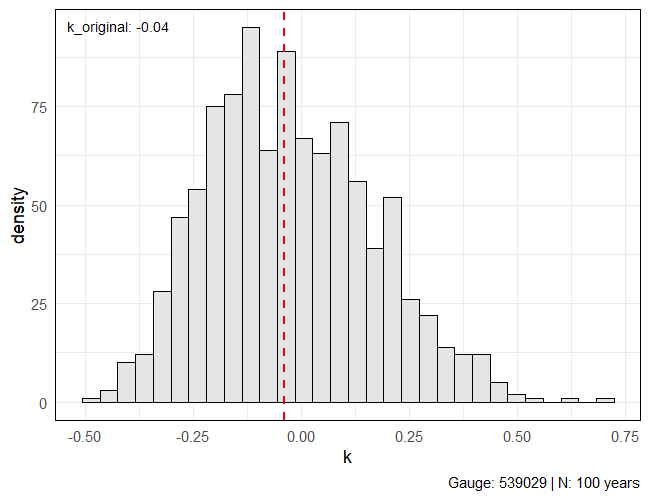

## Motivação (mantra)
A ideia por trás de investigar o ajuste incluindo informação adicional está na realidade do nosso conjunto de estações: são muito curtas. Realizando um experimento bootstrap m-de-n, podemos entender melhor a influência de séries longas na estimativa do parâmetro de forma com momentos-L. Pegamos uma série originalmente com 100 anos de dados que estimou $\hat\kappa_{LMOM} = -0.04$ e fazemos reamostragens de tamanho $M$, em que $M$ tem 15 anos neste exemplo. 



Isso mostra o quão incertas estimativas podem ser para extremos quando temos poucos anos de dados. Com estratégias regionais como essa que estamos avaliando --- construir um modelo de distribuição *a priori* regional para o parâmetro de forma usando GLS --- estamos "*trocando espaço por tempo*" e buscando incorporar informação de outras formas.

Então mesmo que na média, para os dados observados, o modelo de IDF com informação adicional não seja muito diferente do modelo clássico, a diferença que de fato estamos observados é nos extremos, onde o $\kappa$ mais influencia.
## Tarefas
Otimização e verossimilhança:
- [x] Adicionar restrições para `a + kappa` dentro da função `nll.dgev()` seguindo a formulação em `aux_function.R` para a verossimilhança para uma única duração;
- [x] Adicionar distribuição *a priori* para $\kappa$ na função `nll.dgev()`;
- [x] Afrouxar as restrições algumas estações não estão ajustando e retornam `fit$max == 1e6`;
- [x] Parâmetro `theta` está retornando negativo para algumas estações;
Testes realizados
- Otimização **sem** distribuição *a priori* + `method = "Nelder-Mead`: OK
- Otimização **sem** distribuição *a priori* + `method = "L-BFGS-B"`: OK
- Otimização **com** distribuição *a priori* + `method = "Nelder-Mead"`: OK
- Otimização **com** distribuição *a priori* + `method = "L-BFGS-B"`: OK
- - -
## Alguns achados/hipóteses
Intervalos de confiança com bootstrap pode não ser a melhor das opções para séries muito curtas (já é meio óbvio). Gera muita instabilidade no modelo e valores de parâmetro de forma e, consequentemente, quantis muito absurdos.
- - - 
## Parametrização de Koutsoyiannis et al. (1998) e Ulrich et al. (2020)

A base para a parametrização da relação IDF de Koutsoyannis está na forma generalizada proposta:
```math
i = \frac{a(T)}{b(d)}.
```

$b(d)$ nesse caso pode ser escrito como $b(d) = (d + \theta)^\eta$ e $a(T)$ sendo determinada a partir da distribuição de probabilidades de intensidade máxima de chuva $I(d)$.

Considerando que a intensidade $I(d)$ de uma determinada duração $d$ possui distribuição $F_{I(d)}(i,d)$, essa será a mesma distribuição de uma variável $Y$ dada por $Y:=I(d)B(d)$, que nada mais é que a intensidade escalonada por $(d)$.

Essa relação de probabilidades é expressa por:

$$
P\{I(d) \leq i\} = P\{I(d) b(d) \leq i b(d)\} = P\{Y\leq y\},
$$

e também pode ser escrita como

$$
F_{I(d)}(i,d) = F_Y(y_T) = 1 - \frac{1}{T}.
$$

Logo, sendo $y_T$ o quantil $(1 - 1/T)$ da distribuição de CDF $F_Y$, então:

$$
y_T \equiv a(T) = F_Y^{-1}(1 - 1/T).
$$

Se $I(d)\sim GEV (\xi(d), \alpha(d), \kappa)$ e $P\{I(d) \leq i\} = P\{Y \leq y\}$:

```math
F_{I(d)}(y) = \exp \left\{ - \left[ 1 - \kappa\left(\frac{y - \xi}{\alpha}\right) \right]^{1/\kappa} \right\}
```

Para a definição dos quantis, $y_p \equiv a(T)$ , definimos $p$ como a probabilidade de não excedência $p = 1 - 1/T$, e resolvemos $F_Y(y)$ para $y_p$:

```math
\begin{gather}
F_Y(y) = p \implies p = \exp\left\{ - \left[ 1 - \kappa\left(\frac{y - \xi}{\alpha}\right) \right]^{1/\kappa} \right\}, \\
-\log(p) = \left[ 1 - \kappa\left(\frac{y - \xi}{\alpha}\right) \right]^{1/\kappa} \implies \left[ 1 - \kappa\left(\frac{y - \xi}{\alpha}\right) \right] = [-\log(p)]^\kappa, \\
1 - \kappa\left(\frac{y - \xi}{\alpha}\right) = [-\log(p)]^\kappa, \\
\frac{y - \xi}{\alpha} = \frac{1 - [-\log(p)]^\kappa}{\kappa}, \\
y_p = \xi + \frac{\alpha}{\kappa}\left\{ 1 - [-\log(p)]^\kappa \right\} \equiv a(T).
\end{gather}
```

Como os parâmetros $\xi$ e $\alpha$ dependem da duração para qual $y$ foi observado, temos que $\xi = \xi(d)$ e $\alpha = \alpha(d)$. Há evidência suficiente para provar que o parâmetro de forma é incerto o suficiente para que seja razoável defini-lo como constante ao longo de diferentes durações. Pela hipótese de invariância de escala, definimos que há uma relação entre os momentos de diferentes durações:

$$
I(d) \overset{\text{dist}}{=} \left(\frac{d+\theta}{D + \theta}\right)^{-H}I(D).
$$

Essa relação pode ser testada para os momentos $E[I(d)] \sim E[I(D)]$  (sentido amplo) e para os parâmetros de uma distribuição de extremos (sentido restrito). Já discutimos sobre a constância do parâmetro de forma, $\kappa(d) = \kappa$. Para posição e escala, porém, temos:

$$
\xi(d) = \left(\frac{d+\theta}{D + \theta}\right)^{-H} \xi(D), \qquad
\alpha(d) = \left(\frac{d+\theta}{D + \theta}\right)^{-H} \alpha(D).
$$

Isso implica que tanto $\xi(d)\propto (d+\theta)^{-H}$ como $\alpha(d) \propto(d + \theta)^{-H}$. Logo, a razão $\xi(d)/\alpha(d)$ pode ser entendida como constante ao longo das durações $\boldsymbol d$.

Dessa forma, Ulrich et al. (2020) definem uma variável de posição adimensional $\tilde\xi$ definida pela razão entre posição e escala e definem $\alpha_0$ como uma constante de proporcionalidade para a invariância de escala do parâmetro de escala da GEV:

$$
\tilde\xi = \frac{\xi(d)}{\alpha(d)}, \qquad \qquad \alpha(d) = \alpha_0 (d + \theta)^{-H}.
$$

Com essa reparametrização, podemos reescrever a expressão da CDF e do quantil da relação IDF com a distribuição GEV como:

```math
\begin{gather}
F_{I(d)}(i) = \exp\left\{ -\left[ 1- \kappa \left( \frac{i}{\alpha_0(d + \theta)^{-H}} - \tilde\xi \right) \right]^{1/\kappa} \right\}, \\\\\\
%
I(d,T) = \frac{a(T)}{b(d)}, \\\\ y_p = \xi(d) + \frac{\alpha(d)}{\kappa}\left\{ 1 - [-\log(p)]^\kappa \right\} \implies
I(d,p) = \tilde\xi\alpha(d) + \frac{\alpha(d)}{\kappa}\left\{ 1 - [-\log(p)]^\kappa \right\}, \\\\
I(d,T) = \frac{\tilde\xi\alpha_0}{(d+\theta)^H} + \frac{\alpha_0}{\kappa(d+\theta)^H}\left\{ 1 - \left[-\log\left(1-\frac{1}{T}\right)\right]^\kappa \right\}.
\end{gather}
```

## Derivada do logaritmo de $\pi(\kappa)$
A distribuição a priori do parâmetro de forma $\kappa$ pode ser dada por uma distribuição Beta definida entre $[-0.50, +0.50]$ conforme Martins e Stedinger (2000):

$$
\pi(\kappa) = \frac{(0.50 + \kappa)^{p-1}(0.50 - \kappa)^{q-1}}{\Gamma(p)\Gamma(q)/\Gamma(p+q)}
$$

Para combinar à função de log-verossimilhança, tiramos o logaritmo de $\pi(\kappa)$:

$$
\log\pi[(\kappa)] = (p-1)\log(0.50 + \kappa) + (q-1)\log(0.50 - \kappa)
$$

Podemos remover o denominador, pois este não depende de $\kappa$ e não influenciará os parâmetros resultantes durante a otimização. Além disso, também precisamos derivar a expressão acima em função de $\kappa$ para incluí-la na função gradiente.

$$
\frac{\partial\log[\pi(\kappa)]}{\partial\kappa} = \frac{p-1}{0.50 + \kappa} + \frac{q-1}{0.50 - \kappa}
$$
